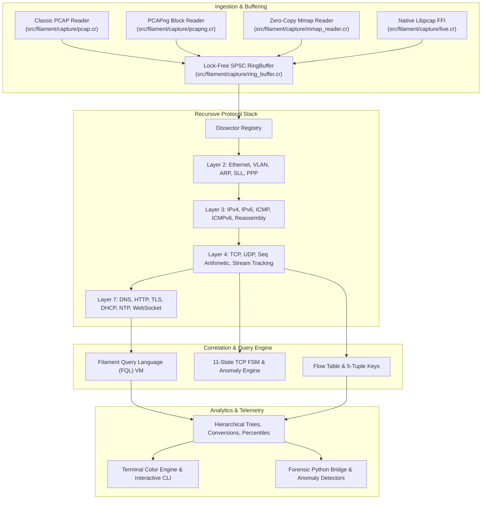

# Filament

[](#)
[](#)
[](LICENSE)

A high-throughput network packet dissection and telemetry engine written in Crystal, featuring hardware-accelerated C kernels and Python forensic integration.

Filament ingests raw network frames from live interfaces or capture traces (classic PCAP and PCAPng), recursively decodes protocol stacks from Layer 2 to Layer 7, tracks TCP connection state machines, evaluates queries using an in-memory register bytecode virtual machine (FQL), and produces real-time traffic telemetry and statistical summaries.

```
  _____ _ _                            _   
 |  ___(_) | __ _ _ __ ___   ___ _ __ | |_ 
 | |_  | | |/ _` | '_ ` _ \ / _ \ '_ \| __|
 |  _| | | | (_| | | | | | |  __/ | | | |_ 
 |_|   |_|_|\__,_|_| |_| |_|\___|_| |_|\__|
 High-Throughput Network Protocol & Telemetry Engine
```

---

## Architecture

Filament decouples ingestion, zero-copy packet buffering, protocol decoding, stateful session correlation, and filtering into distinct pipeline stages:



Detailed technical documentation is available in [`docs/architecture.md`](docs/architecture.md).

---

## Core Features

- **Multi-Format Ingestion**:
  - Classic PCAP (microsecond and nanosecond timestamps, automatic endianness detection).
  - PCAPng (Section Header, Interface Description, Enhanced Packet, and Simple Packet blocks with custom timestamp resolutions).
  - Memory-mapped zero-copy IO via POSIX `mmap(2)` with `MADV_SEQUENTIAL`.
  - Live capture using native `libpcap` C bindings.
  - Thread-safe, lock-free single-producer single-consumer (SPSC) circular ring buffer.

- **Recursive Protocol Dissection**:
  - **Layer 2 (Data Link)**: Ethernet II, IEEE 802.1Q VLAN, IEEE 802.1ad QinQ, ARP/RARP (with gratuitous ARP and probe detection), Linux Cooked mode (SLL v1/v2), Point-to-Point Protocol (PPP).
  - **Layer 3 (Network)**: IPv4 (with RFC 1071 checksum verification, option parsing, and RFC 815 out-of-order fragment reassembly), IPv6 (RFC 5952 zero-compressed formatting and extension header traversal), ICMPv4 and ICMPv6 (with embedded packet recovery).
  - **Layer 4 (Transport)**: TCP (flag parsing, options decoding for MSS, Window Scale, SACK, Timestamps), UDP (datagram validation and pseudo-header checksum verification), RFC 1982 modular sequence space arithmetic, and out-of-order TCP stream reassembly.
  - **Layer 7 (Application)**: DNS (RFC 1035 wire parser with loop-safe compression pointer resolution), HTTP/1.1 (requests, responses, header dictionaries, chunked bodies), TLS (Record Layer, ClientHello, ServerHello, SNI, ALPN, cipher suites), DHCP/BOOTP (TLV options), NTPv4 (64-bit epoch timestamps), WebSocket (RFC 6455 framing and XOR unmasking).

- **Stateful Flow Tracking & TCP State Machine**:
  - 5-tuple canonical flow hashing with bidirectional volume and duration accounting.
  - Full RFC 793 / RFC 9293 11-state TCP finite state machine.
  - Real-time transport anomaly detection: Retransmissions, Fast Retransmissions, Zero Window advertisements, Window Full conditions, and Out-of-Order arrivals.
  - Handshake round-trip time (RTT) calculation.

- **Filament Query Language (FQL)**:
  - Strongly-typed filtering DSL compiled via Pratt precedence parsing into custom register-based bytecode.
  - Short-circuit boolean logic (`and`, `or`, `not`), relational operators (`==`, `!=`, `<`, `<=`, `>`, `>=`), CIDR subnet matching (`in`), and protocol presence checks.
  - Zero-allocation VM execution per packet. Complete specification in [`docs/fql_reference.md`](docs/fql_reference.md).

- **Hardware Acceleration Kernels**:
  - 64-bit unrolled RFC 1071 internet checksum routines in C (`ext/checksum/`).
  - ARM NEON SIMD hex dump conversion kernel (`ext/hexsimd/`) utilizing vector table lookups (`vqtbl1_u8`).

- **Python Forensic Bridge**:
  - Streamlined dataframe exports (`analysis/filament_bridge.py`) for Jupyter, Pandas, and Polars.
  - Automated anomaly detection (`analysis/anomaly_detector.py`) for SYN/FIN/NULL port scans, Shannon entropy DNS data exfiltration, and TLS version downgrades.
  - Vector SVG Stevens sequence plots and terminal ASCII histograms (`analysis/visualizer.py`).

---

## Installation & Requirements

### Prerequisites

- **Crystal**: 1.10.0 or later (`brew install crystal` on macOS, or via package manager on Linux)
- **Shards**: Crystal dependency manager (bundled with Crystal)
- **C Compiler**: `clang` or `gcc` (with ARM NEON support on ARM64 or SWAR on x86_64)
- **libpcap**: System packet capture library (included on macOS and standard Linux distributions)
- **Python 3**: (Optional, for `analysis/` tools) Python 3.9+

### Building from Source

Clone the repository and build the binary:

```bash
git clone https://github.com/Aneesh495/filament.git
cd filament
make release
```

This compiles an optimized release binary to `./bin/filament`.

To compile a development build:

```bash
make build
```

---

## Quick Start & CLI Usage

### 1. Offline PCAP Analysis

Inspect a capture file and display decoded packet headers:

```bash
./bin/filament -r traffic.pcap
```

Display detailed hexadecimal packet dumps alongside headers:

```bash
./bin/filament -r traffic.pcap -x
```

### 2. Filtering with FQL

Filter for DNS queries resolving specific domain names:

```bash
./bin/filament -r traffic.pcap -Y 'dns and dns.qname == "example.com"'
```

Filter for TCP packets targeting HTTP or HTTPS ports with SYN flag set:

```bash
./bin/filament -r traffic.pcap -Y 'tcp.flags.syn and (tcp.dst_port == 80 or tcp.dst_port == 443)'
```

Filter by CIDR subnet membership:

```bash
./bin/filament -r traffic.pcap -Y 'ip.src in 10.0.0.0/8 and not (ip.dst in 10.0.0.0/8)'
```

### 3. Comprehensive Traffic Forensics Report

Generate a summary report including protocol hierarchy distributions, top endpoints, bidirectional conversations, and TCP anomalies:

```bash
./bin/filament -r traffic.pcap -q --summary
```

Example report output:

```
================================================================================
                          FILAMENT TRAFFIC FORENSICS REPORT
================================================================================

Total Packets Analyzed : 14,290
Total Bytes Ingested   : 11,842,914 (11.29 MB)
Active Flow Entries    : 342
Capture Duration       : 42.18s
Throughput Rate        : 2.24 Mbps

--------------------------------------------------------------------------------
1. PROTOCOL HIERARCHY
--------------------------------------------------------------------------------
  Ethernet                                        14,290 pkts (100.0%)
    IPv4                                          14,102 pkts  (98.7%)
      TCP                                         12,450 pkts  (87.1%)
        TLS                                        8,210 pkts  (57.5%)
        HTTP                                         420 pkts   (2.9%)
      UDP                                          1,652 pkts  (11.6%)
        DNS                                        1,652 pkts  (11.6%)
    ARP                                              188 pkts   (1.3%)

--------------------------------------------------------------------------------
2. TOP ENDPOINTS (BY VOLUME)
--------------------------------------------------------------------------------
  10.0.1.45                                        6.42 MB ( 7,812 pkts)
  104.244.42.1                                     3.81 MB ( 4,520 pkts)
  1.1.1.1                                        124.50 KB ( 1,652 pkts)

--------------------------------------------------------------------------------
3. TRANSPORT ANOMALIES DETECTED
--------------------------------------------------------------------------------
  TCP Retransmissions                              18 pkts
  TCP Fast Retransmissions                          4 pkts
  TCP Out-of-Order Segments                         7 pkts
  TCP Zero Window Advertisements                    0 pkts
================================================================================
```

### 4. Live Interface Capture

Capture packets live from interface `en0` with a Berkeley Packet Filter:

```bash
sudo ./bin/filament -i en0 -f "tcp port 443"
```

---

## Command-Line Interface Reference

```
Usage: filament [options]

Capture & Input Options:
    -r FILE, --read FILE             Read packets from PCAP/PCAPng capture file
    -i IFACE, --interface IFACE      Capture packets live from network interface
    -f BPF, --bpf BPF                Berkeley Packet Filter expression for live capture
    -m, --mmap                       Use memory-mapped IO for offline capture reading

Dissection & Filtering:
    -Y FILTER, --fql FILTER          Filament Query Language (FQL) filter expression
    -c COUNT, --count COUNT          Stop after processing COUNT packets
    -x, --hex                        Print packet byte hex dump alongside dissection

Reporting & Output:
    -q, --quiet                      Suppress per-packet line output
    -s, --summary                    Display comprehensive traffic forensics report
    -j, --json                       Output decoded packet stream as JSON lines
    --no-color                       Disable terminal ANSI color formatting

Informational:
    -v, --version                    Display Filament version
    -h, --help                       Show this help message
```

---

## Python Forensic Bridge

The `analysis/` directory contains tools for downstream data analysis and anomaly detection:

```bash
# Convert packet capture to a Pandas DataFrame
python3 -c "
from analysis.filament_bridge import FilamentBridge
df = FilamentBridge.load_packets('traffic.json')
print(df.head())
"

# Run automated anomaly detection heuristics
python3 -m analysis.anomaly_detector traffic.json

# Render an SVG Stevens sequence plot of a TCP flow
python3 -m analysis.visualizer traffic.json --flow 10.0.0.1:54321-93.184.216.34:443 --output seq.svg
```

---

## Test Suite & Verification

Filament includes test suites covering capture parsing, protocol dissections, flow tracking, FQL compilation, and end-to-end pipeline processing:

```bash
# Run all unit, structure, and integration specifications
make test
```

All 45+ test cases execute in milliseconds with zero dependencies.

---

## Contributing & Development

- System architecture: [`docs/architecture.md`](docs/architecture.md)
- Custom protocol dissectors: [`docs/dissector_guide.md`](docs/dissector_guide.md)
- FQL filter language specification: [`docs/fql_reference.md`](docs/fql_reference.md)

Format and check codebase conformance:

```bash
make fmt   # Format Crystal source code
make lint  # Verify code style formatting
```

---

## License

Filament is open-source software licensed under the [MIT License](LICENSE).
