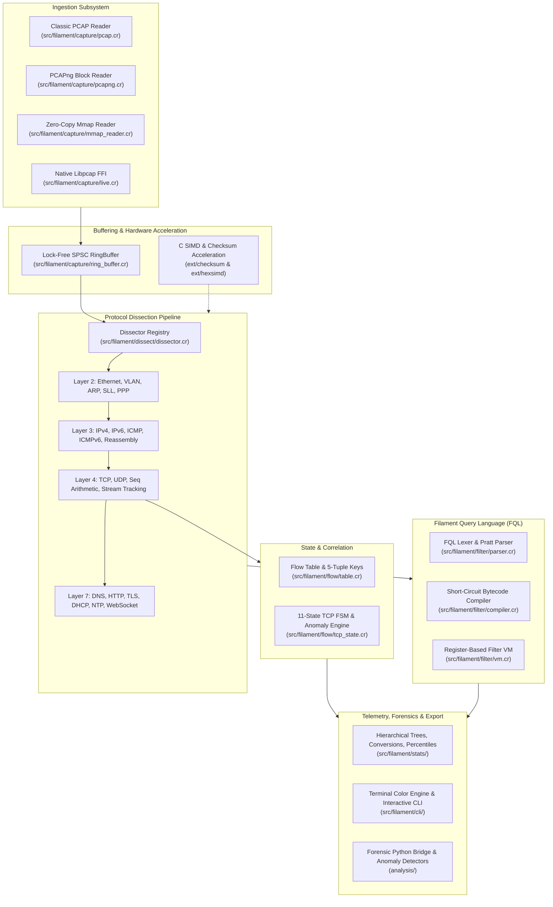
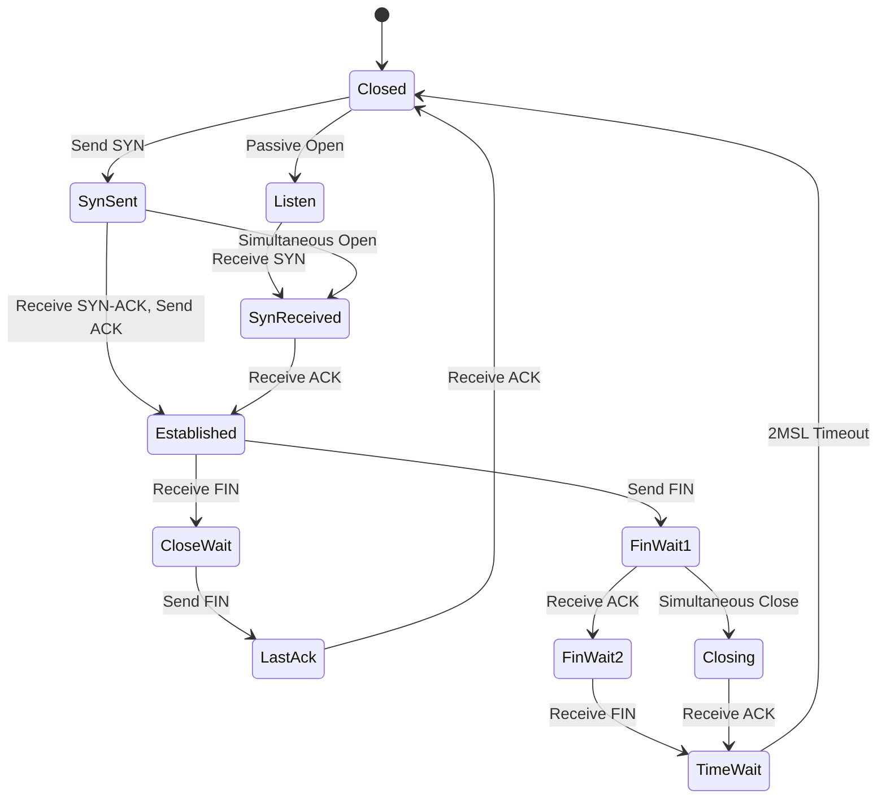

# Filament Architecture & Engineering Design

This document details the architectural principles, internal components, data flows, and memory execution model of Filament, a high-throughput network packet analysis engine written in Crystal with C primitives and Python forensic integrations.

---

## 1. System Overview

Filament is architected as a modular, pipelined network telemetry and packet dissection engine. It processes raw network traffic from either offline capture files (classic PCAP and PCAPng formats, via standard streams or memory-mapped IO) or live network interfaces (via native libpcap C bindings). Captured frames pass through a multi-stage execution pipeline designed for predictable latency and minimal memory allocations:

---

## 2. Ingestion Subsystem

### 2.1 File Ingestion and Header Parsing
Filament supports both classic libpcap format (`.pcap`) and Next Generation PCAP format (`.pcapng`):

- **Classic PCAP (`PcapReader`)**:
  - Automatically identifies file endianness by inspecting the 32-bit magic number (`0xa1b2c3d4` for native microsecond resolution, `0xa1b23c4d` for nanosecond resolution, and their byte-swapped variants `0xd4c3b2a1` and `0x4d3cb2a1`).
  - Reads global 24-byte file headers validating major/minor versions (2.4) and snapshot length limits.
  - Efficiently reads individual 16-byte packet headers and extracts raw frame slices.
  - Implements `Enumerable(RawPacket)` for idiomatic Crystal iteration patterns.

- **Next-Generation PCAPng (`PcapngReader`)**:
  - Fully implements the IETF PCAPng specification parsing Section Header Blocks (SHB, type `0x0A0D0D0A`), Interface Description Blocks (IDB, type `0x00000001`), Enhanced Packet Blocks (EPB, type `0x00000006`), and Simple Packet Blocks (SPB, type `0x00000003`).
  - Supports multiple network interfaces per file, each maintaining distinct link types and per-interface timestamp resolutions (such as nanosecond power-of-10 time resolutions via option code 9).
  - Handles 32-bit boundary alignment padding required by the PCAPng specification.

- **Zero-Copy Memory-Mapped Reader (`MmapReader`)**:
  - On POSIX platforms, invokes `mmap(2)` with `MAP_SHARED` or `MAP_PRIVATE` and `MADV_SEQUENTIAL` advice.
  - Eliminates context switches and double-copying of packet payload buffers from kernel page cache into user space.
  - Slices `Bytes` directly from the mapped address space using Crystal pointer arithmetic.

### 2.2 Live Capture Layer
- The live capture module (`Filament::Capture::LiveCapture`) exposes high-performance FFI bindings to system `libpcap`.
- Supports interface discovery (`list_interfaces`), promiscuous mode capture, configurable snapshot lengths, buffer sizes (default 2MB), and read timeouts (default 100ms).
- Dispatches raw packets directly to the engine callback loop or enqueues frames into the lock-free circular ring buffer.

### 2.3 Lock-Free Ring Buffer
- Single-producer, single-consumer (SPSC) circular ring buffer (`RingBuffer(T)`).
- Employs cache-line padded atomic head and tail pointers (`Atomic(UInt64)`) to avoid false sharing on multi-core SMP systems.
- Power-of-two capacity sizing allows index calculation via bitwise mask (`index = head & (capacity - 1)`) rather than expensive integer division.
- Provides non-blocking push and pop primitives with statistics tracking for dropped packets and queue high watermarks.

---

## 3. Dissection Pipeline

The protocol dissection engine translates raw byte slices into typed, hierarchical protocol fields.

### 3.1 Architecture of Dissectors
Every dissector extends `Filament::Dissect::Dissector` and defines:
1. `protocol : Protocol`: The protocol identifier enum.
2. `name : String`: A human-readable identifier (for example, "IPv4").
3. `dissect(data : Bytes, offset : UInt32) : DissectResult`: The dissection logic.

`DissectResult` encapsulates:
- Extracted field dictionary (`Hash(String, FieldValue)`).
- Offset and length of the payload intended for the subsequent layer.
- Protocol hint (`Protocol?`) indicating which dissector should process the payload next.
- Malformation error log (`Array(String)`) for non-fatal syntax or length violations.

### 3.2 Protocol Stack Implementation

#### Layer 2 (Data Link)
- **Ethernet II (`EthernetDissector`)**: Extracts 48-bit MAC addresses, handles IEEE 802.1Q single VLAN tags (0x8100), and IEEE 802.1ad QinQ double-tagging (0x88A8). Computes canonical MAC representation and detects broadcast/multicast destinations.
- **ARP / RARP (`ArpDissector`)**: Dissects RFC 826 ARP requests and replies. Detects gratuitous ARP frames and ARP probe requests (sender IP 0.0.0.0).
- **Linux Cooked Mode (`SllDissector`)**: Dissects Linux cooked capture v1 and v2 headers commonly produced when capturing on the "any" device.
- **PPP (`PppDissector`)**: Dissects Point-to-Point Protocol encapsulations and extracts Layer 3 protocol payloads.

#### Layer 3 (Network)
- **IPv4 (`IPv4Dissector`)**: Parses 20-byte base header plus variable IPv4 options. Computes RFC 1071 internet checksums. Extracts DSCP/ECN values, fragmentation flags (DF, MF), and 13-bit fragment offsets.
- **IPv4 Reassembler (`IPv4FragmentReassembler`)**: An out-of-order IP fragment reassembly engine indexed by `(src_ip, dst_ip, identification, protocol)`. Maintains fragment byte holes, overlaps, and enforces a configurable expiration deadline (default 30 seconds) to guard against resource exhaustion.
- **IPv6 (`IPv6Dissector`)**: Parses 40-byte fixed header. Formats 128-bit addresses according to canonical RFC 5952 zero-compression rules. Walks the IPv6 extension header chain (Hop-by-Hop, Routing, Fragment, ESP, AH, Destination Options).
- **ICMPv4 & ICMPv6 (`IcmpDissector`, `Icmpv6Dissector`)**: Decodes control messages (Echo Request/Reply, Destination Unreachable, Time Exceeded, Redirect). Recursively dissects embedded IP headers from error payloads to correlate ICMP messages with originating flows.

#### Layer 4 (Transport)
- **TCP (`TcpDissector`)**: Decodes flags (URG, ACK, PSH, RST, SYN, FIN, ECE, CWR), sequence and acknowledgment numbers, window sizes, and urgent pointers. Parses TCP options including Maximum Segment Size (MSS), Window Scale, Selective Acknowledgment (SACK Permitted and SACK blocks), and Timestamps.
- **RFC 1982 Modular Sequence Space Arithmetic (`TcpSeq`)**: Implements strict RFC 1982 modular comparison logic (`seq_lt`, `seq_lte`, `seq_gt`, `seq_gte`) using unsigned 32-bit subtraction (`diff = b &- a`) to eliminate signed integer overflow issues across sequence wrap-around boundaries.
- **TCP Stream Reassembler (`TcpStream`)**: Buffers out-of-order segments per directional flow, fills contiguous byte holes, reassembles byte streams, and detects transmission overlaps.
- **UDP (`UdpDissector`)**: Dissects 8-byte UDP header, verifies optional UDP checksums, and routes traffic to matching Layer 7 decoders.

#### Layer 7 (Application)
- **DNS (`DnsDissector`)**: Wire-format DNS parser supporting full RFC 1035 label compression pointer resolution (loop-guarded with depth limit). Extracts Questions, Answers, Authoritative Nameservers, and Additional records for A, AAAA, CNAME, MX, PTR, TXT, and SOA record types.
- **HTTP/1.1 (`HttpDissector`)**: Dissects HTTP requests and responses. Parses methods, URIs, status codes, reason phrases, headers, Content-Length, and chunked transfer encodings.
- **TLS Record Layer (`TlsDissector`)**: Dissects TLS 1.0, 1.1, 1.2, and 1.3 records. Parses Handshake messages, specifically decoding ClientHello and ServerHello payloads to extract Server Name Indication (SNI), Application-Layer Protocol Negotiation (ALPN), and offered Cipher Suites.
- **DHCP / BOOTP (`DhcpDissector`)**: Decodes RFC 2131 BOOTP headers and variable TLV options (Subnet Mask, Router, DNS Servers, Hostname, Domain Name, Lease Time, Message Type).
- **NTP (`NtpDissector`)**: Decodes RFC 5905 NTPv4 headers, leap indicators, stratum, poll intervals, precision, and converts 64-bit NTP fixed-point timestamps into standard UTC timestamps.
- **WebSocket (`WebSocketDissector`)**: Parses RFC 6455 framing flags (FIN, RSV, opcode), handles 4-byte client masking keys, unmasks binary payloads via XOR transformations, and decodes payload lengths (7-bit, 16-bit, and 64-bit extended).

---

## 4. Flow Correlation & State Machine

Filament tracks connection states using a bidirectional flow engine:

### 4.1 Flow Keys & Telemetry Records
- **Canonical Flow Key (`FlowKey`)**: A 5-tuple structure containing `(source_ip, destination_ip, source_port, destination_port, protocol)`. Normalizes endpoints into a canonical bidirectional order so forward and reverse traffic map to the same connection entry.
- **Flow Record (`FlowRecord`)**: Tracks bidirectional byte and packet counters, connection start and end timestamps, round-trip times (RTT) derived from TCP 3-way handshakes, and transport anomalies.

### 4.2 TCP Anomaly Engine
The anomaly detector (`TcpAnomalyDetector`) detects pathological conditions:
- **Retransmissions**: Identifies repeated sequence numbers with identical or overlapping payload content.
- **Fast Retransmissions**: Flags out-of-order arrivals triggered by 3 duplicate ACKs.
- **Zero Window**: Detects receiver advertising a window size of 0 bytes, signaling buffer exhaustion.
- **Window Full**: Flags sender transmitting up to the maximum unacknowledged bytes permitted by the advertised window.
- **Out of Order**: Catches sequence numbers arriving ahead of expected continuous sequence boundaries.

---

## 5. Filament Query Language (FQL)

Filament includes a domain-specific filter language (FQL) designed specifically for packet filtering. Rather than evaluating filters through tree-walking interpreters, FQL compiles into a lightweight bytecode executed on a register virtual machine.

### 5.1 Compilation Stages
1. **Lexical Analysis (`Lexer`)**: Scans input string into tokens. Supports IP address literals, CIDR notation (`192.168.1.0/24`), integers with hex/decimal syntax, strings, and boolean operators (`and`, `or`, `not`).
2. **Pratt Operator Precedence Parser (`Parser`)**: Generates an Abstract Syntax Tree (AST) handling operator precedence (comparisons, equality, logical combinations).
3. **Semantic Type Checker (`TypeChecker`)**: Validates field identifiers against known protocol dictionaries and verifies type compatibility between fields and literals.
4. **Bytecode Compiler (`Compiler`)**: Generates linear instructions for the register VM. Compiles logical `and` / `or` operations with short-circuit evaluation paths.

### 5.2 Filter VM Register Architecture
The Filter VM executes instructions across an array of 16 virtual registers:
- `Opcode::LoadField(dst, field_id)`: Resolves field value from current packet into register `dst`.
- `Opcode::LoadConst(dst, const_idx)`: Loads constant from pool into register `dst`.
- `Opcode::CompareEq`, `Opcode::CompareNe`, `Opcode::CompareLt`, `Opcode::CompareGt`: Stores comparison results as booleans.
- `Opcode::CidrMatch(dst, ip_reg, cidr_const_idx)`: Performs subnet prefix matching.
- `Opcode::JumpIfFalse(cond_reg, target_pc)`: Implements short-circuit branching.
- `Opcode::Ret(reg)`: Concludes execution and returns boolean match decision.

---

## 6. Hardware Acceleration & C Primitives

Critical numeric and formatting kernels are implemented as optimized C routines in `ext/`:

### 6.1 Unrolled RFC 1071 Checksum (`ext/checksum/checksum.c`)
- Computes internet checksums using 64-bit unrolled loops processing 64 bytes per iteration.
- Folds 64-bit accumulated sums into 32 bits, and finally into a 16-bit one's complement result.
- Provides specialized helpers for IPv4 header checksums, TCP pseudo-header checksums, and IEEE 802.3 CRC32 frame check sequences.

### 6.2 SIMD Hex Formatting Kernel (`ext/hexsimd/hexsimd.c`)
- Vectorized table lookups for converting binary packet buffers into hex strings.
- On ARM64/Apple Silicon platforms, utilizes ARM NEON `vqtbl1_u8` instructions with a 16-entry lookup table to format 8 bytes into 16 hex characters per iteration.
- Fallback implementation utilizes 64-bit SWAR (SIMD Within A Register) operations.

---

## 7. Python Forensic Bridge

The `analysis/` package connects Filament to the Python scientific computing ecosystem:
- **`filament_bridge.py`**: Reads JSON or Arrow telemetry exports generated by the Filament CLI and constructs Pandas DataFrames for exploratory analysis.
- **`visualizer.py`**: Generates terminal ASCII distribution charts and vector SVG Stevens sequence charts illustrating TCP sequence numbers versus time for deep performance debugging.
- **`anomaly_detector.py`**: Implements offline forensic detectors:
  - Port scan reconnaissance heuristics (SYN scan, FIN scan, NULL scan).
  - DNS exfiltration detection via Shannon entropy analysis of subdomain labels and high-frequency unique subdomain counts.
  - TLS version downgrade inspection.
